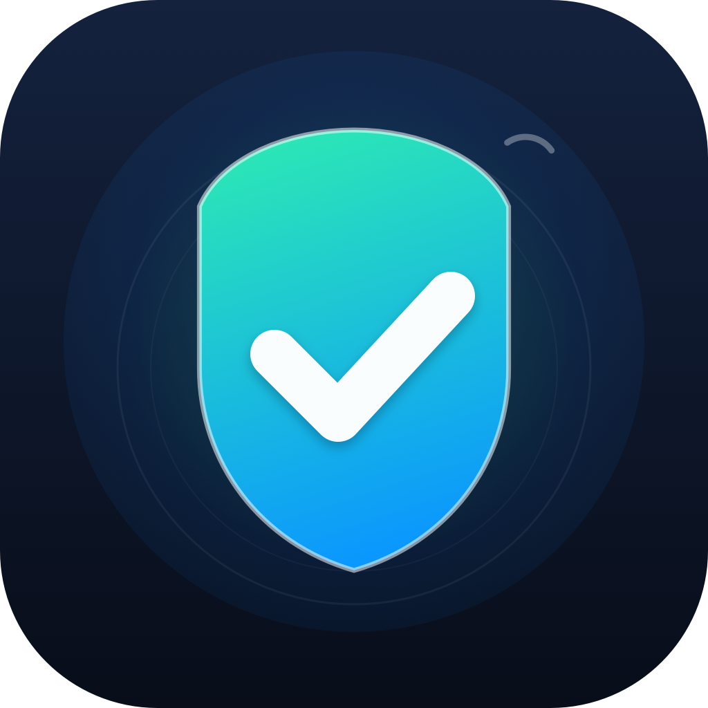
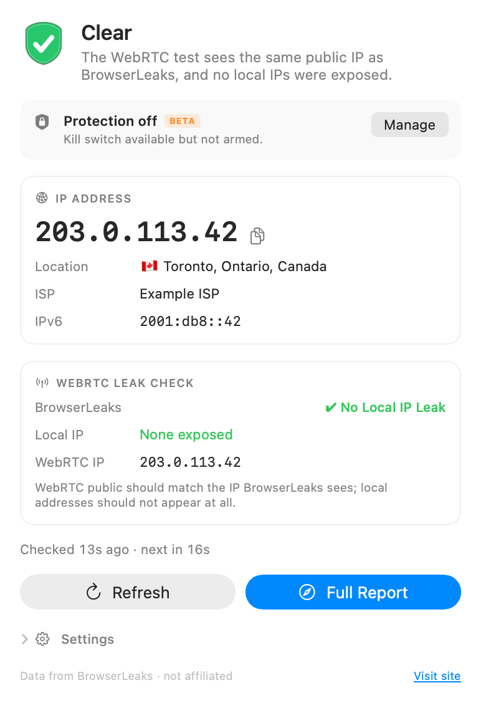
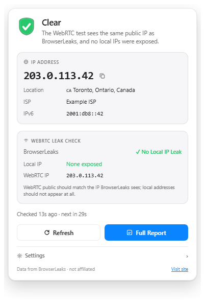
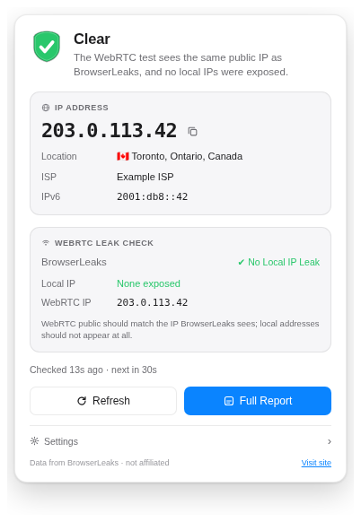
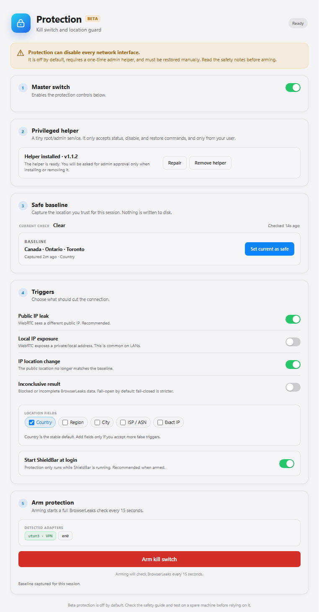
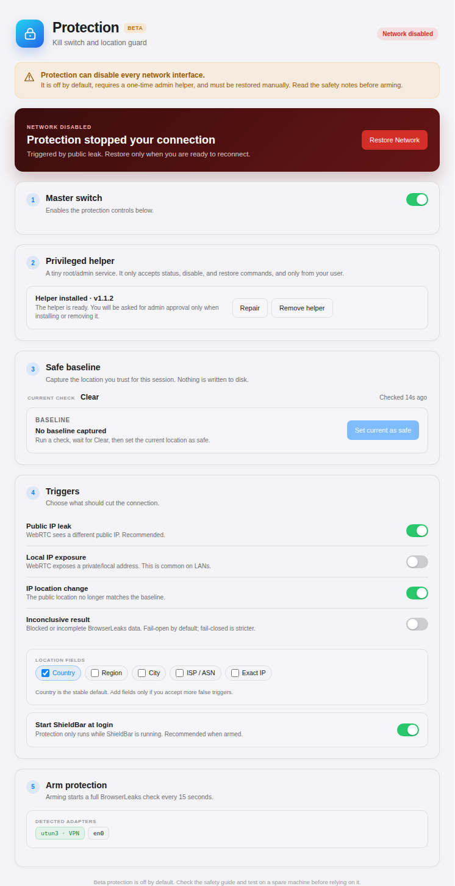
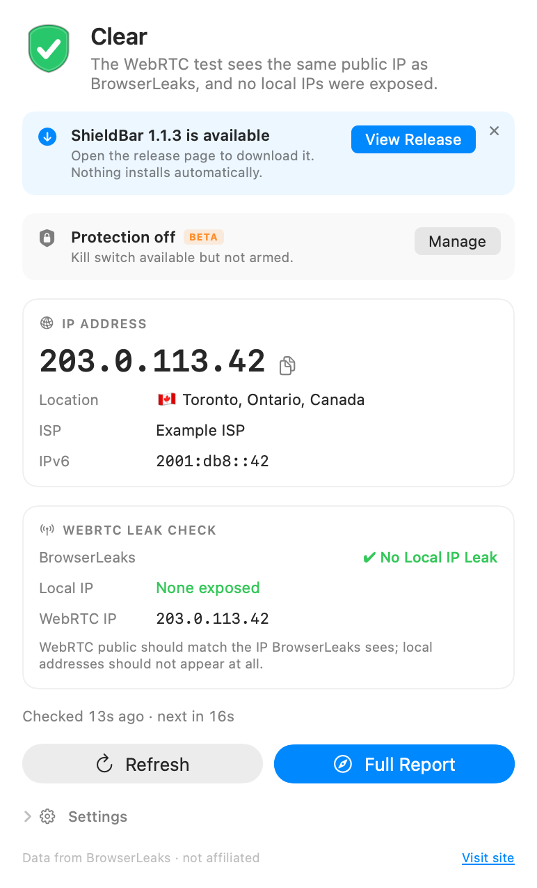
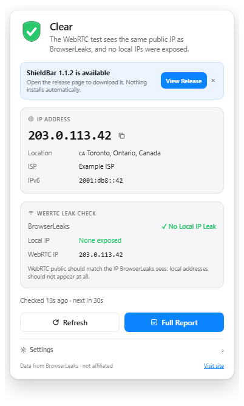
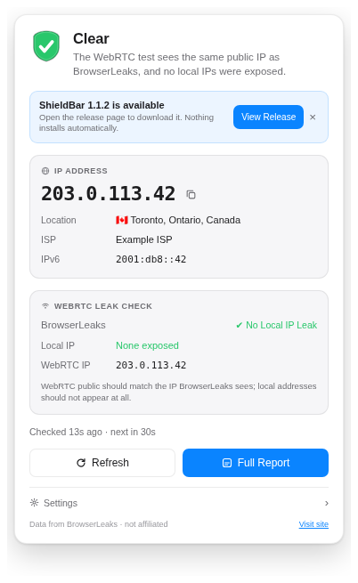

<p align="center">
  
</p>

<h1 align="center">ShieldBar</h1>

<p align="center">
  <strong>Public IP and WebRTC leak monitoring for your menu bar or system tray.</strong><br>
  <sub>See what the network exposes. Catch a mismatch. Cut the connection when it matters.</sub>
</p>

<p align="center">
  
  
  
  
  
  
  
</p>

<p align="center">
  
  
  
</p>

<p align="center"><sub>macOS menu bar · Windows system tray · Linux system tray — all showing Clear, with documentation-only IP ranges</sub></p>

<p align="center"><sub><a href="docs/screenshots/README.md">See every status on every platform →</a></sub></p>

## Download

[**ShieldBar v1.1.2**](https://github.com/TH3L30/ShieldBar/releases/tag/v1.1.2) · [SHA256SUMS.txt](https://github.com/TH3L30/ShieldBar/releases/tag/v1.1.2)

| Platform | Requires | Asset |
| --- | --- | --- |
| macOS | macOS 13+, Apple silicon | [`ShieldBar-1.1.2-macos-arm64.zip`](https://github.com/TH3L30/ShieldBar/releases/tag/v1.1.2)* |
| Windows | Windows 10/11, x64 | [`ShieldBar-1.1.2-win-x64.exe`](https://github.com/TH3L30/ShieldBar/releases/tag/v1.1.2) · [`ShieldBar-1.1.2-win-x64.zip`](https://github.com/TH3L30/ShieldBar/releases/tag/v1.1.2) |
| Linux | x64, glibc-based distro | [`ShieldBar-1.1.2-linux-x86_64.AppImage`](https://github.com/TH3L30/ShieldBar/releases/tag/v1.1.2) · [`ShieldBar-1.1.2-linux-amd64.deb`](https://github.com/TH3L30/ShieldBar/releases/tag/v1.1.2) |

<sub>* The macOS build is arm64, ad-hoc signed, and not notarized. Windows and Linux builds are unsigned. Verify downloads against `SHA256SUMS.txt`. There is no auto-update.</sub>

## What it does

- **Shows the public IP** reported by BrowserLeaks, plus location, ISP, IPv6, and the time of the last check.
- **Runs a strict WebRTC check** through ShieldBar's embedded engine and reports Clear, Public IP leak, Local IP exposed, Inconclusive, or Offline.
- **Opens the live BrowserLeaks report** in a separate window, restricted to `browserleaks.com`.
- **Offers an optional Protection (Beta) kill switch** that disables networking when a configured condition fires.

The WebRTC check exercises ShieldBar's own embedded WebKit or Chromium path. It cannot inspect Chrome's, Safari's, Firefox's, or another browser's private WebRTC stack.

## Protection (Beta)

> [!WARNING]
> **Destructive by design.** When armed and triggered, Protection disables **every non-loopback network interface**. It does **not** restore them automatically. Calls, downloads, remote sessions, and local access can drop immediately, and the machine can stay offline until you restore it manually.

Protection is off by default. It requires a one-time privileged helper (admin/root approval), a baseline captured from a Clear result, and manual arming after your VPN is connected. While armed, ShieldBar loads the full BrowserLeaks page every 15 seconds. ShieldBar must stay running: the helper does not monitor the network on its own. Real physical-NIC testing on Windows and macOS is still pending, which is why this feature is Beta.

Read the [Protection kill switch guide](docs/KILL-SWITCH.md) before enabling it.

<p align="center">
  
  
</p>

## Status rules

Clear is the only green state. It requires **all** of the following:

1. The BrowserLeaks page completed and returned a public IPv4 address.
2. The WebRTC test completed with a final public candidate.
3. Every WebRTC public address matches the page address after IPv4/IPv6 normalization.
4. No local/private WebRTC address is exposed.

| | Status | Meaning |
| --- | --- | --- |
| 🟢 | **Clear** | Public IPs match and no local IP is exposed. |
| 🔴 | **Public IP leak** | WebRTC sees a different public IP. Takes precedence over local exposure. |
| 🟡 | **Local IP exposed** | Public IPs match, but a private/local WebRTC address is visible. |
| 🟡 | **Inconclusive** | Blocked, unsupported, timed out, or incomplete data. Never shown as green. |
| ⚪ | **Offline** | BrowserLeaks could not be reached. |
| 🔵 | **Checking** | A full check is running. |
| ⚪ | **Not checked** | No check has completed yet. |

Missing data is never treated as success. Public leak takes precedence over local exposure; Inconclusive never becomes Clear.

## Privacy

- No accounts, analytics, telemetry, or IP history.
- Probe and report sessions are in-memory; browsing data is discarded, and probe caches are cleared after every check.
- Protection baselines are session-only. The exact-IP option is kept only as a salted hash in memory.
- Notifications never contain IP addresses; the helper logs interface names and states, not addresses.

See [docs/PRIVACY.md](docs/PRIVACY.md) for the full data-handling details.

## Install

- **macOS:** unzip, move `ShieldBar.app` to Applications, then Control-click → **Open** the first time. Requires Apple silicon.
- **Windows:** run the `.exe` installer, or unpack the portable `.zip`. SmartScreen will warn because the build is unsigned.
- **Linux:** `chmod +x` the AppImage and run it, or install the `.deb` with `sudo apt install ./ShieldBar-1.1.2-linux-amd64.deb`.

ShieldBar lives in the **menu bar** on macOS and the **system tray** on Windows and Linux. It keeps running when windows close; use **Quit ShieldBar** to exit. Protection requires ShieldBar to stay running.

## Updates

ShieldBar checks a signed release feed at launch and every 24 hours, shows an in-app banner plus one notification per version, and opens the GitHub release page when you choose **View Release**. Nothing downloads or installs automatically. You can disable automatic checks in Settings; manual **Check for Updates…** remains available.

See [docs/UPDATES.md](docs/UPDATES.md) for the feed schema, signature verification, privacy, and troubleshooting.

<p align="center">
  
  
  
</p>

## Platform notes

<details>
<summary><strong>macOS</strong> — arm64, menu bar, ad-hoc signed</summary>

Requires macOS 13 or later on Apple silicon. The app is ad-hoc signed and not notarized, so Gatekeeper may require Control-click → Open. Builds from source use the macOS 26.5 SDK; see [docs/BUILD.md](docs/BUILD.md). If networking is disabled by Protection, run the recovery CLI from the app's actual location:

```sh
~/Applications/ShieldBar.app/Contents/MacOS/ShieldBar --restore-network
```

</details>

<details>
<summary><strong>Windows</strong> — x64, system tray, unsigned</summary>

Supports Windows 10/11 x64. The per-user NSIS installer does not require administrator rights; the Protection helper does. SmartScreen warns on first launch. Toast notifications are tied to the installer's Start Menu shortcut, so the portable zip may not show them unless you create a shortcut. If Protection disables networking, run `ShieldBar.exe --restore-network` or use the system tray. No auto-update.

</details>

<details>
<summary><strong>Linux</strong> — x64, system tray, AppImage or .deb</summary>

Supports x64 glibc-based distributions; primarily tested on Ubuntu 24.04. GNOME needs the **AppIndicator and KStatusNotifierItem Support** extension. Wayland compositors may ignore popover positioning. The AppImage requires FUSE; use `--appimage-extract-and-run` if FUSE is unavailable. If Protection disables networking, run the AppImage or installed `shieldbar` with `--restore-network`. Notifications require a running notification daemon. No auto-update.

</details>

## Documentation

| Document | Contents |
| --- | --- |
| [Protection (Beta)](docs/KILL-SWITCH.md) | Kill switch behavior, recovery, failure modes, test status |
| [Architecture](docs/ARCHITECTURE.md) | Probes, strict evaluator, cadence, helper protocol, process boundaries |
| [Build](docs/BUILD.md) | macOS and Electron builds, helper builds, packaging, CI, releases |
| [Update alerts](docs/UPDATES.md) | Signed release feed, notification behavior, opt-out, feed verification |
| [Privacy](docs/PRIVACY.md) | Exactly what is stored, sent, and discarded |
| [Troubleshooting](docs/TROUBLESHOOTING.md) | Helper, restore, system tray, Gatekeeper, SmartScreen, FUSE, rate limits |
| [Desktop README](desktop/README.md) | Windows/Linux-specific setup and packaging |
| [Screenshot gallery](docs/screenshots/README.md) | Every state on every platform |

## License

MIT © 2026 TH3L30. See [LICENSE](LICENSE).

## Attribution

IP address and WebRTC data are provided by [BrowserLeaks](https://browserleaks.com/ip). BrowserLeaks and its content belong to their respective owners. ShieldBar is an independent project and is not affiliated with or endorsed by BrowserLeaks. Please be considerate: the default background cadence is 15 minutes, not continuous polling.
