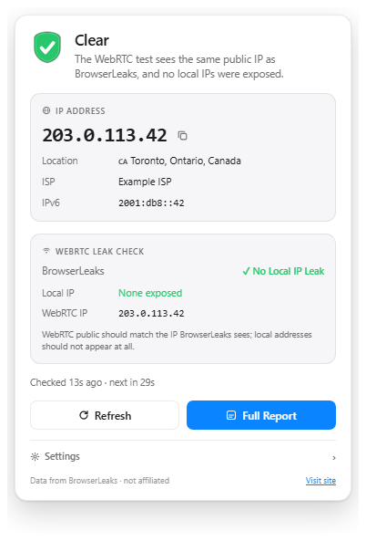
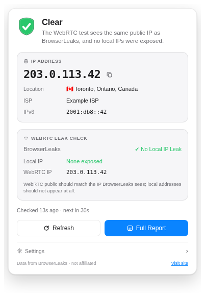

# ShieldBar for Windows and Linux

ShieldBar is an Electron + TypeScript tray app that shows the public IP reported by [BrowserLeaks](https://browserleaks.com/ip) and checks whether WebRTC exposes a different public IP or a local/private address.

This is the Windows/Linux companion to the native macOS app. It follows the same strict status rules, probe contract, check cadence, Protection behavior, and privacy model. For the product overview and downloads, see the [root README](../README.md).

ShieldBar is an independent project and is not affiliated with BrowserLeaks.

## Screenshots

Captured by the real Electron app on each platform with documentation-only IP ranges:

<p>
  
  
</p>

See the [screenshot gallery](../docs/screenshots/README.md) for leak, local-exposure, welcome, inconclusive, and offline states.

## What it does

- Tray icon whose color and glyph reflect the latest strict verdict
- Summary popover with public IP, location, ISP, IPv6, and WebRTC results
- Full BrowserLeaks report in a dedicated, non-persistent window
- Leak notification only when the status changes to **Public IP leak**
- Optional **Protection (Beta)** kill switch with a separate Protection window
- No IP history, telemetry, accounts, or analytics

## Protection (Beta)

Protection is off by default. It requires a one-time privileged helper installed with UAC, polkit, or an administrator prompt. When armed and triggered, the helper disables **every non-loopback network interface** and does **not** restore them automatically.

- Arm manually after the VPN is connected, from a Clear result with a captured baseline.
- Public-leak and location-change triggers are on by default; local-IP exposure and fail-closed are off by default.
- A full BrowserLeaks check runs every 15 seconds while armed.
- The system tray menu shows **Protection…** and, when triggered, **Restore Network** at the top.
- The Protection window is separate from the summary popover.
- A notification fires when Protection triggers.
- Start-at-login is available in Protection settings; it starts the app, not the kill switch.

The app supports `--restore-network` from its executable, so you can recover without opening a window. The system tray menu, the helper's `restore` command, and the operating system's network settings remain available as fallbacks. See the [Protection kill switch guide](../docs/KILL-SWITCH.md) before enabling it.

## Updates

ShieldBar checks a signed GitHub release feed about 8 seconds after launch and every 24 hours. It shows an in-app banner and one OS notification per version; **View Release** opens the release page. Nothing downloads or installs automatically.

- **Check for Updates…** is in the tray menu and the popover Settings.
- **Check for updates automatically** can be disabled in Settings.
- The manifest is Ed25519-signed and verified against an embedded public key before parsing.
- The check contacts GitHub and reveals normal network metadata, including your IP, to GitHub. No device identifier or usage data is sent.

See [docs/UPDATES.md](../docs/UPDATES.md) for the feed contract, signing, privacy, and troubleshooting.

## Status rules

Green is only possible when **all** of these hold:

1. The BrowserLeaks page completed and returned a public IPv4 address.
2. The WebRTC test completed with final local and public cells.
3. Every WebRTC public address matches a page address after IPv4/IPv6 normalization.
4. No local/private WebRTC address is exposed.

| Status | Meaning |
| --- | --- |
| **Clear** (green) | Public IPs match and no local IP is exposed. |
| **Public IP leak** (red) | WebRTC sees a different public IP. Takes precedence over local exposure. |
| **Local IP exposed** (amber) | Public IPs match, but a private/local WebRTC address is visible. |
| **Inconclusive** (amber) | Blocked, unsupported, timed out, or incomplete data. Never shown as green. |
| **Offline** (gray) | BrowserLeaks could not be reached. |
| **Checking** (blue) | A check is running. |
| **Not checked** (gray) | No check has completed yet. |

Missing data is never treated as success. A missing local-IP row is an incomplete result, not “no local leak.”

The WebRTC test runs in bundled Chromium, not in Chrome, Edge, Firefox, or Safari. It exercises the system network path and the VPN/proxy routing Chromium uses; other browsers implement their own WebRTC policies.

## Check cadence

The popover freshness line updates every second. That is a renderer heartbeat, not a network test.

- Immediately at launch and when the popover opens, if the last result is older than 8 seconds
- Every **30 seconds** while the popover is open
- Every **15 minutes** in the background
- Every **60 seconds** while offline
- Every **15 seconds** while Protection is armed
- Immediately on a network transition and after resume from sleep, following a short settle delay

Checks never overlap. A request during a check is queued once. The full BrowserLeaks page is loaded for each check; the background cadence is intentionally conservative.

## Build and test

Requirements: Node.js 22.12 or newer, npm, Go 1.23 or newer, and the platform you want to package on. Cross-packaging is only partially supported; GitHub Actions builds both platforms reliably.

```sh
cd desktop
npm ci
npm run helper     # builds all three helper binaries, requires Go

npm run dev        # development window/tray
npm run typecheck
npm test           # Vitest unit tests, no network
npm run build
npm run smoke      # headless renderer/preload smoke test
npm run self-test  # live BrowserLeaks check, redacted output
npm run preview    # offscreen UI previews in desktop/preview/
```

`npm run helper` is required for a working Protection helper and for packaging. It cross-builds the helper for macOS, Windows, and Linux into `resources/helper`; the app reports a missing binary if it has not been run.

The live self-test exits non-zero when a complete IP + WebRTC result cannot be read. A red or amber verdict is a valid finding, not a test failure.

For full build, icon, CI, and release details, see [docs/BUILD.md](../docs/BUILD.md).

## Package

```sh
npm run dist:win    # NSIS installer + portable zip (x64)
npm run dist:linux  # AppImage + .deb (x64)
```

Artifacts are written to `desktop/release/`:

- `ShieldBar-1.1.2-win-x64.exe` — per-user NSIS installer
- `ShieldBar-1.1.2-win-x64.zip` — portable zip
- `ShieldBar-1.1.2-linux-x86_64.AppImage`
- `ShieldBar-1.1.2-linux-amd64.deb`

Builds are unsigned. Windows SmartScreen warns about an unknown publisher; Linux packages are unsigned too. There is no auto-updater.

## Platform caveats

### Windows

- x64 only; Windows 10/11.
- The installer is per-user and does not require administrator rights. The Protection helper does.
- Unsigned, so SmartScreen warns on first launch.
- Notifications require Windows notification settings to allow ShieldBar. Toasts are associated with the installer's Start Menu shortcut; the portable zip may not show them unless you create a shortcut.
- Security software may block the helper's scheduled task.

### Linux

- x64 only; primarily tested on Ubuntu 24.04.
- The tray uses StatusNotifier/AppIndicator. GNOME requires the **AppIndicator and KStatusNotifierItem Support** extension; KDE, XFCE, and Cinnamon generally work without extra setup.
- On Wayland, compositors may ignore requested popover positioning or always-on-top hints. ShieldBar falls back to positioning near the cursor.
- AppImage requires FUSE. On systems without FUSE, run it with `--appimage-extract-and-run`.
- If the tray icon is unavailable, launch ShieldBar again from the application menu. The single-instance handler opens the summary popover.
- Notification delivery depends on a running notification daemon.

### Both

- The app is tray-only: closing the popover or report window does not quit it. Use **Quit ShieldBar** from the tray menu.
- Quitting while Protection is armed disarms it. Quitting while triggered leaves networking disabled.
- The full report window is a live Chromium view, not a cached report.
- No auto-update.

## GitHub Actions

`.github/workflows/desktop-build.yml` runs on pushes to `main` that touch `desktop/**`, on manual dispatch, and on `v*` tags:

1. Ubuntu: typecheck, Vitest, `go test ./...`, bundle build, headless smoke test, and a non-blocking live BrowserLeaks self-test.
2. Windows and Ubuntu matrix: build the helper, package x64 targets, smoke-test the unpacked executable, and upload artifacts.
3. Tag pushes: create a **draft** GitHub release with the artifacts and `SHA256SUMS.txt`.

No code-signing secrets are used. The macOS app is not built by this workflow.

## Privacy

- No analytics, telemetry, accounts, or IP history.
- Probe and report windows use non-persistent Electron sessions; probe storage and cache are cleared after every check.
- IP addresses are not written to notifications or application logs.
- The full report window only navigates within `browserleaks.com`; external links open in the default browser.
- All page permission requests are denied in probe and report sessions.

The settings file stores preferences and Protection choices only: notification and welcome booleans, trigger toggles, selected baseline fields, fail-closed, and start-at-login. It never stores IP addresses or baselines. See [docs/PRIVACY.md](../docs/PRIVACY.md).

## Project layout

```text
desktop/
  src/core/            models, normalization, evaluator, schedule, DOM extraction,
                       probe completion rules, Protection baseline/evaluator
  src/main/            Electron lifecycle, monitor, probe, tray, popover, report,
                       settings, notifications, Protection, helper client/install
  src/preload/         contextBridge API
  src/renderer/        React dashboard, Protection window, preview fixtures
  src/shared/          IPC contract, cadence constants, Protection types
  scripts/             icon and helper build scripts
  build/               Windows .ico and Linux icon set
  resources/           app icon, tray PNGs, generated helper binaries
  tests/               Vitest unit tests
  electron-builder.yml packaging configuration
```

## Attribution

IP address and WebRTC data are provided by [BrowserLeaks](https://browserleaks.com/ip). BrowserLeaks and its content belong to their respective owners. ShieldBar is not affiliated with or endorsed by BrowserLeaks. Please be considerate: the default background cadence is 15 minutes, not continuous polling.
