# Screenshots

The summary card uses documentation-only IP ranges (RFC 5737 and RFC 3849).
No live IP addresses or browsing data are shown.

The Windows and Linux captures were rendered by the real Electron app on each
platform. The macOS captures were rendered by the native SwiftUI app.

## macOS (native)

  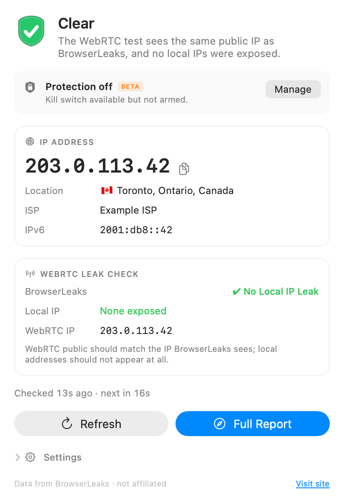
  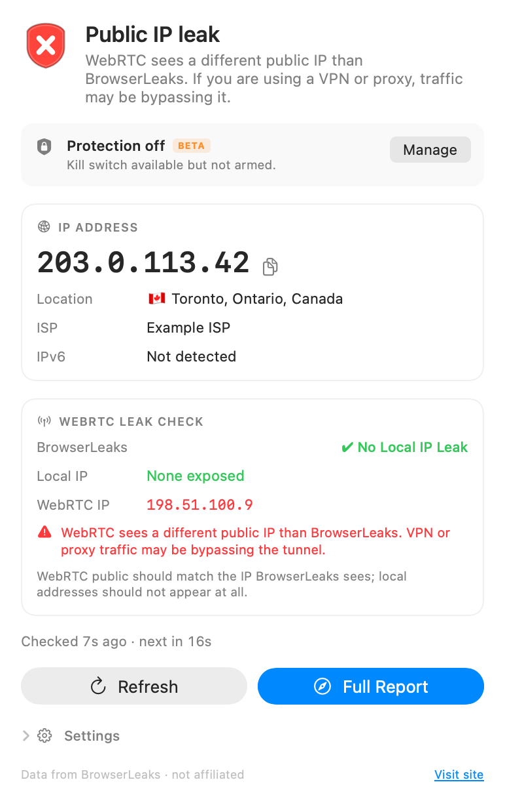
  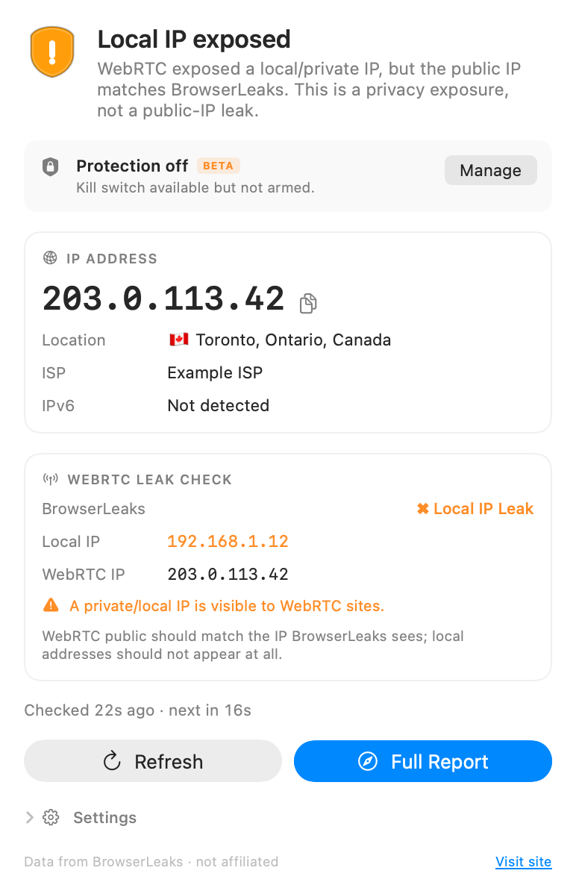

  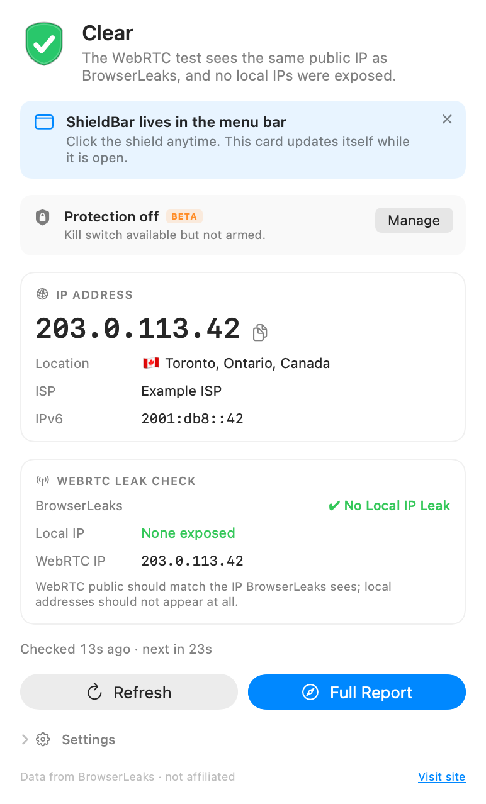
  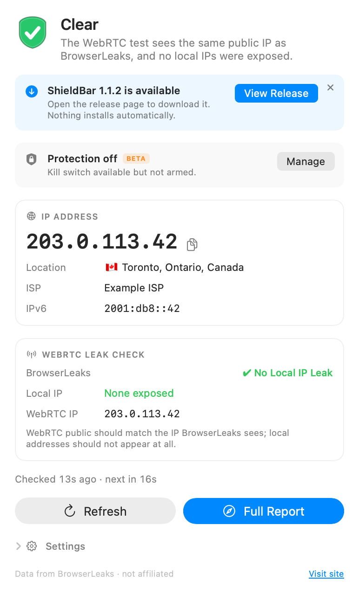

Menu-bar status icons:

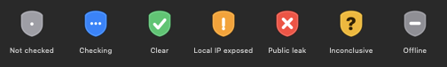

Protection (Beta) window:

  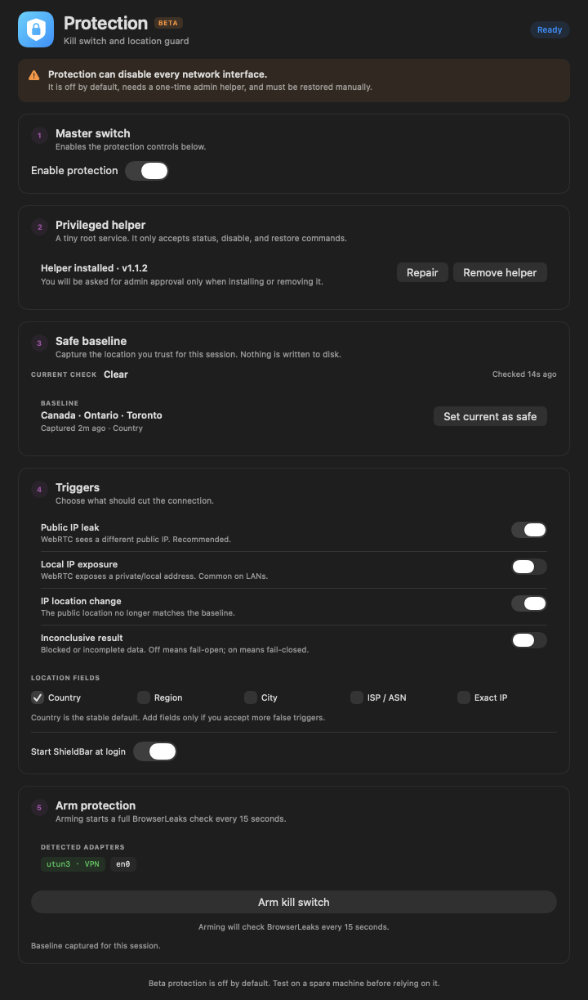
  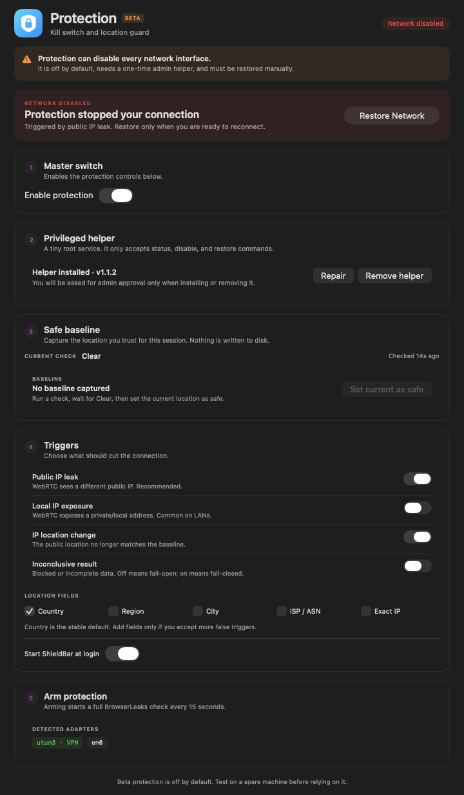

## Windows (Electron)

  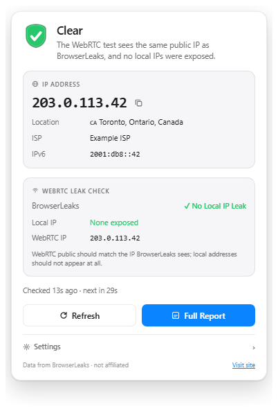
  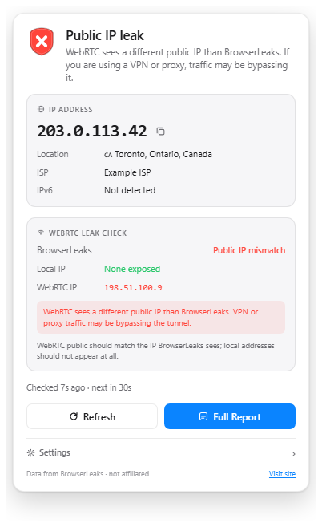
  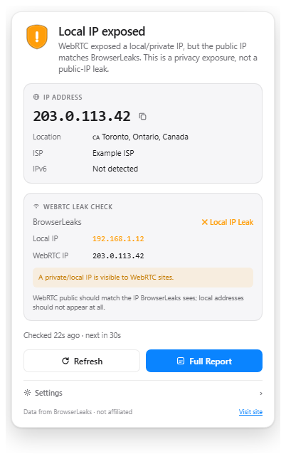

  
  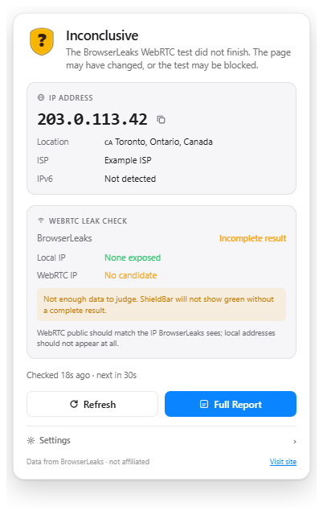
  

Protection (Beta) window:

  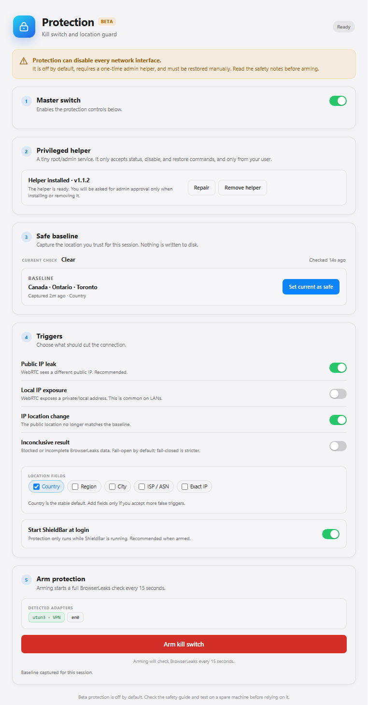
  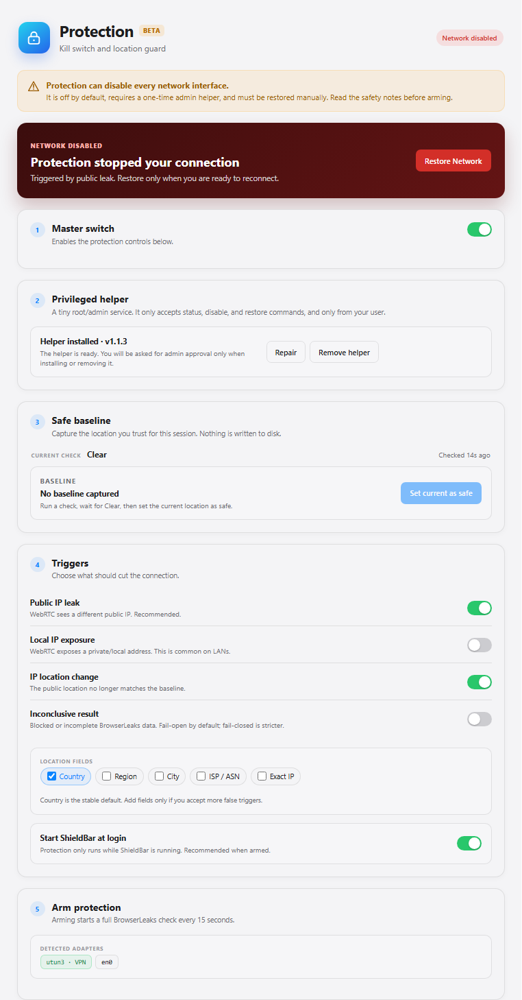

## Linux (Electron)

  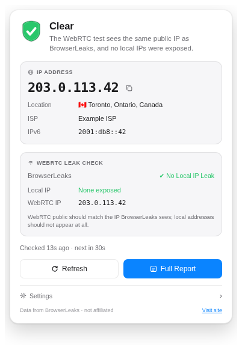
  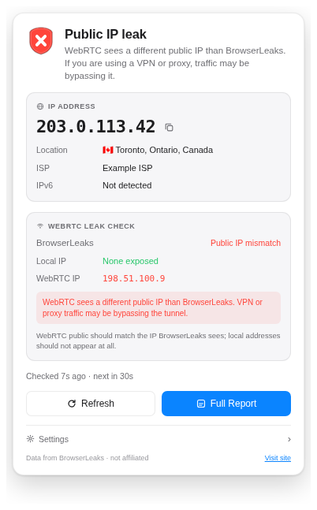
  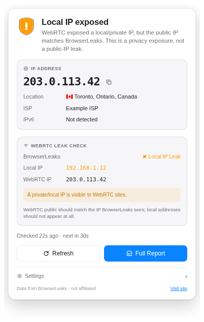

  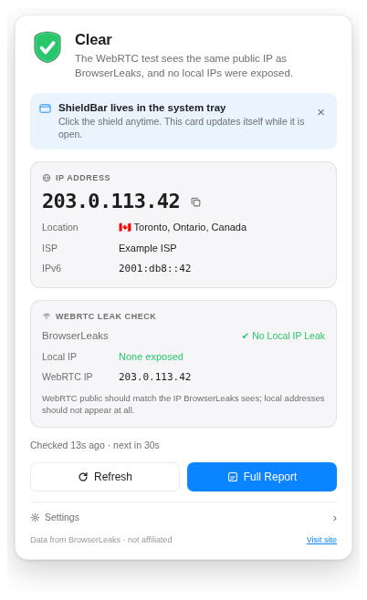
  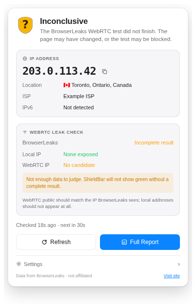
  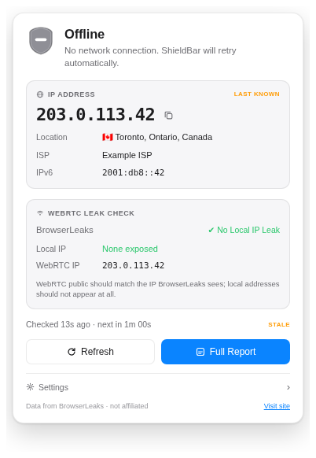

Protection (Beta) window:

  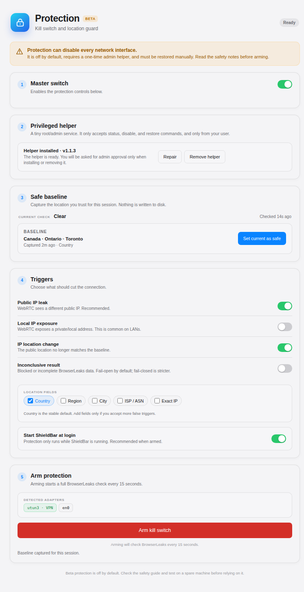
  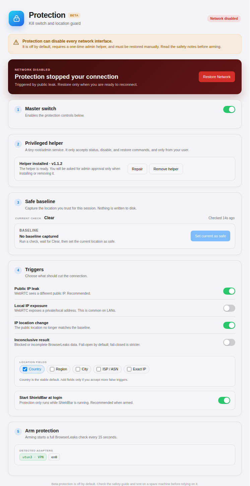

## Status colors

The shield color and glyph are consistent across platforms:

| Status | Color | Glyph |
| --- | --- | --- |
| Clear | Green | Check |
| Public IP leak | Red | X |
| Local IP exposed | Amber | Exclamation |
| Inconclusive | Amber | Question mark |
| Offline | Gray | Dash |
| Checking | Blue | Three dots |
| Not checked | Gray | Dot |

Windows renders flag emoji as the two-letter country code rather than a flag;
this is a Windows font limitation, not missing location data.
